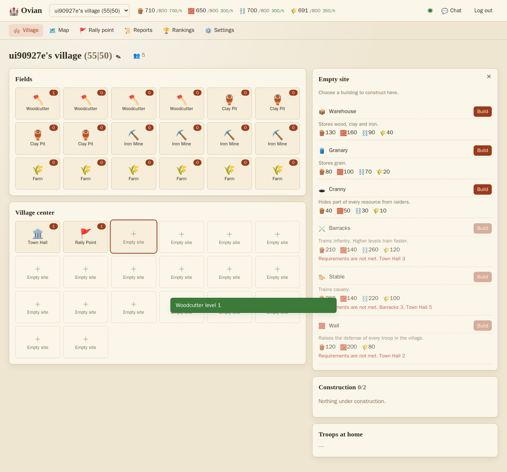
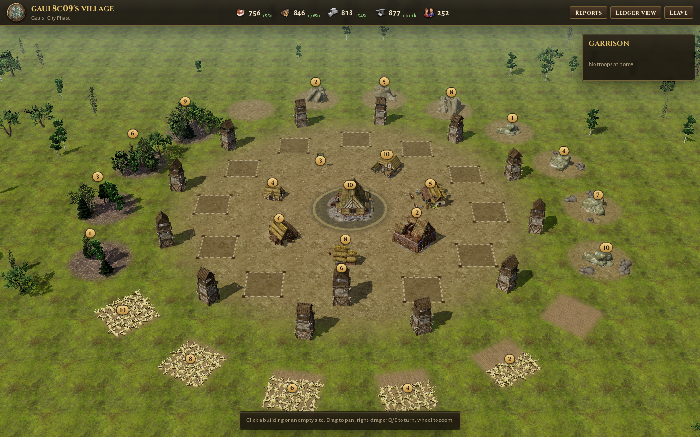

# Ovian

An open-source browser strategy game in the tradition of Travian, Ikariam and Grepolis.
You found a village, grow its economy, train troops and raid, attack or reinforce other players on a shared map.

Ovian is built to be reshaped:

- **Rules are data.** A content pack (YAML) defines resources, buildings, units, tribes, the map and combat. The repo ships a continental Travian-like pack, an island Ikariam-like pack, and **antiquity**: fifteen civilizations whose units are converted from [0 A.D.](https://play0ad.com)'s simulation data.
- **The server is a plugin host.** Every feature, built-in or third-party, is a module registered through Python hooks. Plugins can add endpoints, timed jobs, MQTT handlers, veto orders, or change battles.
- **The client is skinnable, and replaceable.** The ledger client takes skins: a manifest (labels, icons, map colours, layout) plus a CSS file, inheriting from each other and switched at runtime. A second client, the **diorama**, shows each city in 3D with 0 A.D. art.
- **Cities grow in phases.** As the town hall rises, a village becomes a town and a city, which opens more building sites. It then becomes a metropolis, capital and imperial seat (levels 20, 40 and 60). From the city on, each phase adds a builder, so more constructions run at once.
- **Culture and technology.** Temples and universities radiate culture that wins prestige in battles against neighbouring cities, and research a small tech tree that unlocks advanced units.
- **The API is the game.** The backend is a pure REST API with an OpenAPI schema; the web client is just one client. Realtime updates go over MQTT.





## Architecture

| Part | Tech | Role |
|---|---|---|
| `engine/` | Rust | Pure rules: economy, construction, training, combat, travel, procedural map. No I/O. Exposed to Python with PyO3 and to the browser as WebAssembly. |
| `server/` | Python, FastAPI, Postgres | REST API, persistence, the job scheduler, plugins. Every game decision is delegated to the engine. |
| `broker/` | Mosquitto + go-auth | MQTT for realtime. Logins and topic permissions are checked by the server. |
| `web/` | Angular | Two browser clients sharing one core: the ledger (`web/src`) and the 3D diorama (`web/projects/diorama`). Both run the engine in WebAssembly for live counters and previews. |
| `tools/zeroad/` | Python | Converts 0 A.D. data into the antiquity pack and bakes its art for the diorama. |
| `content/` | YAML | Content packs. |

See [docs/architecture.md](docs/architecture.md) for the full picture.

## Quick start

Everything runs in Docker. You need Docker with Compose v2.

```sh
cp .env.example .env        # then change the secrets
docker compose up -d --build
```

| What | URL |
|---|---|
| Game, ledger client | http://localhost:47173 |
| Game, diorama client | http://localhost:47174 (run `tools/zeroad/bake.sh` once first) |
| API docs (OpenAPI) | http://localhost:47080/docs |
| MQTT over WebSocket | ws://localhost:47173/mqtt (proxied) or ws://localhost:47001 |

Both clients work on phones. In the diorama: tap to select, drag to pan, two fingers to turn and zoom the city or pinch the world map; the garrison opens from the round button.

For a fast development world set `OVIAN_WORLD_SPEED=50` in `.env`.
Alliances, the market, scouting and a battle simulator, heroes, barbarian camps, quests, gods, great buildings, vacation, achievements and the wonder race are described in [docs/society.md](docs/society.md). Contentment and unrest, governments, seasons and the summer games, omens, roads and trade routes, espionage, weekly medals, the chronicle (with a GeoJSON export), world rounds with a hall of fame, bans and the tutorial are in [docs/realm.md](docs/realm.md).

An AI assistant (Claude or any MCP client) can run your cities with a personal access token through the MCP server: see [docs/mcp.md](docs/mcp.md).

Superusers get an Admin screen in both clients, listing every player: online now, last login, login count and their cities. Clicking a city opens it read-only (`GET /api/v1/admin/villages/{id}`); on the diorama map, admins also get "Look inside" for any city. Name them in `OVIAN_ADMIN_USERS=alice,bob`. The API is `GET /api/v1/admin/players`.
To play another ruleset set `OVIAN_PACK=isles` or `OVIAN_PACK=antiquity`, and give each world its own database with `OVIAN_DATABASE_NAME`.

Angular with live reload:

```sh
docker compose --profile dev up web-dev    # http://localhost:47200
```

The dev server needs the WebAssembly engine in `web/public/engine/`. Build it once with:

```sh
DOCKER_BUILDKIT=1 docker build -f docker/wasm.Dockerfile -o web/public/engine .
```

## Tests

```sh
# Rust rules, including validation of every shipped content pack
docker run --rm -v "$PWD:/src" -w /src/engine rust:1-slim-bookworm cargo test -p ovian-engine

# Server, against a throwaway Postgres
docker compose -f docker-compose.test.yml run --build --rm server-tests

# Against a running stack: realtime (MQTT + ACLs) and a browser walkthrough
docker run --rm --network ovian_default -v "$PWD/scripts:/s:ro" python:3.12-slim \
  sh -c "pip -q install paho-mqtt httpx && python /s/smoke_realtime.py"
docker run --rm --network ovian_default -v "$PWD/scripts:/s:ro" -v "$PWD/shots:/shots" \
  mcr.microsoft.com/playwright/python:v1.49.0-noble \
  sh -c "pip -q install --break-system-packages playwright==1.49.0 && python /s/e2e_ui.py"
# same for the diorama: python /s/e2e_diorama.py
```

## Customising

- [Content packs](docs/content-packs.md): change rules, numbers, buildings, units, tribes and the map.
- [Server plugins](docs/modding.md): add features and change behaviour in Python.
- [Skins](docs/skins.md): change the look and the vocabulary of the client.
- [Realtime](docs/realtime.md): MQTT topics, payloads and permissions, for writing other clients and bots.
- [Antiquity](docs/antiquity.md): how 0 A.D. units become Ovian units.
- [Diorama](docs/diorama.md): the 3D client and its art pipeline.
- [Many worlds](docs/worlds.md): the hub, one account for every world, founders, badges and Patreon.
- [OpenFantasyMaps](docs/ofm.md): a proposal for running a world on an OFM map.

## AI rulers (bots)

The optional `bots` service fills a world with a few friendly NPC kingdoms led by historical rulers (Pericles of Athens, Hannibal of Carthage, Vercingetorix of Alesia...). They play only through the public HTTP API, like any client: they build, train, raid barbarian camps, answer omens, pick a government and enter festivals, but never attack players. A very small local model served by [Ollama](https://ollama.com) (default `hf.co/prism-ml/Bonsai-1.7B-gguf:Q1_0`, about 250 MB) gives them a voice in the global chat; without it they use canned lines.

```bash
# in .env
COMPOSE_PROFILES=bots
OVIAN_BOTS=Pericles:athen:statesman;Hannibal:cart:general;Vercingetorix:gaul:warlord
OVIAN_BOT_USERS=Pericles,Hannibal,Vercingetorix   # marks them as bots in rankings and on the map
OVIAN_BOT_PASSWORD=<a long random string>
docker compose up -d server && docker compose up -d --build bots
```

Details, personas and settings: [docs/bots.md](docs/bots.md).

## Licences

Ovian is MIT licensed, with two exceptions:

- `content/antiquity` is generated from 0 A.D. data and is GPL-2.0-or-later.
- The baked 0 A.D. art used by the diorama is CC BY-SA 3.0. It is not in git; see `tools/zeroad/bake.sh`.

## What exists today

Accounts, village founding on a procedural map, eighteen resource fields, six growth phases that open building sites and add builders, repeatable and unique buildings, temples and universities with culture and a tech tree, a construction queue, troop training, attacks, raids, reinforcements, recall, looting with hiding places, walls, battle reports, rankings, chat, beginner protection, three skins, fifteen 0 A.D. civilizations and the 3D diorama client.

Not yet: settling or conquering more villages, alliances, a marketplace and trade, scouting, heroes, oases, naval movement for the isles pack, and world end conditions. The architecture leaves room for each of them as a module plus engine rules. The diorama has every screen except chat. It does not animate units or marching armies yet.

## License

MIT, except as noted under [Licences](#licences). Ovian is an independent project and is not affiliated with the makers of Travian, Ikariam or Grepolis. All names and numbers in the classic and isles packs are original. The antiquity pack and the diorama art come from 0 A.D. by Wildfire Games, under its licences.
