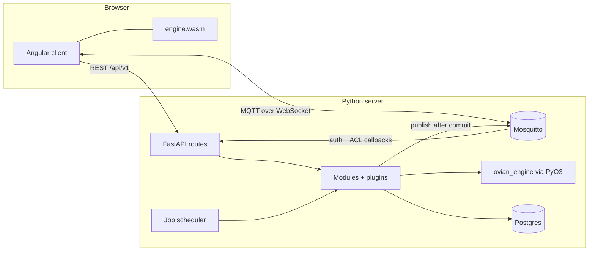

# Architecture

## Principles

1. **One source of rules.** All game maths lives in the Rust crate `engine/crates/ovian-engine`. The server calls it through PyO3 and the browser through WebAssembly, so a cost preview in the browser is exactly what the server will charge.
2. **The engine is pure.** It takes state and returns new state. It never reads a clock, a database or a socket. Times are passed in as epoch milliseconds.
3. **The server owns time and persistence.** Resources are stored lazily (`amount at time T` plus rates) and brought up to date with `Engine.accrue` whenever a village is touched. Anything that happens later is a row in the `jobs` table.
4. **Commands go over REST, events go over MQTT.** Every state change is a REST call that returns the new state. After the transaction commits, the server publishes the same snapshot to the player's MQTT topic, so other tabs and devices update too.
5. **Everything is a module.** Built-in features register through the same plugin hook as third-party code.

## Engine (`engine/`)

| Crate | Purpose |
|---|---|
| `ovian-engine` | Pack schema and validation, economy, construction and training plans, battle resolution, loot, travel time, map generators. |
| `ovian-py` | PyO3 bindings. State crosses as dicts; rule violations raise `PlanError("<code>")`. Built into a wheel with maturin. |
| `ovian-wasm` | wasm-bindgen bindings for the browser. Plans return `{ok, plan}` or `{ok: false, error}`. |

The map is procedural: terrain is a hash of `(seed, x, y)`, so only villages are stored.

## Server (`server/`)

- `game.py` holds the `Game` object: settings, content, plugin manager, the database pool, realtime and the scheduler.
- `Game.tx()` opens a transaction. Messages queued with `tx.publish` or `game.event` are sent only after a successful commit.
- `Game.run_due()` takes the oldest due job with `FOR UPDATE SKIP LOCKED`, deletes it and runs its handler, all in one transaction. A failure rolls back, the job is retried with backoff and marked failed after five attempts. Several server processes can share one database.
- `modules/` holds the built-in features: auth, villages (construction and training), military (movements and battles), world (map, players, rankings, content), reports, chat and the broker callbacks.
- `plugins/` holds optional plugins shipped with the server, such as beginner protection.

### Data model

| Table | Holds |
|---|---|
| `players` | Accounts, tribe, protection end, free-form `meta`. |
| `villages` | Position, owner and the engine state as JSON. |
| `jobs` | Construction, training, arrivals and plugin jobs, keyed by due time. |
| `movements` | Troops on the road. |
| `stationed` | Reinforcements sitting in someone else's village. |
| `reports`, `chat_messages` | Player-facing history. |

## Realtime (`broker/`)

Mosquitto with the go-auth plugin delegates every login and topic check to `/internal/mqtt/*` on the server. Players log in with their player id as the username and their API token as the password. Details are in [realtime.md](realtime.md).

## Client (`web/`)

- `core/` has the API client, session and game store, the WASM engine wrapper, MQTT, and the skin service.
- `features.ts` is the feature registry. Routes and navigation are generated from it.
- `features/*` holds one standalone component per screen.
- `public/skins/*` holds the skins. `public/config.json` is written at container start, so one build serves any deployment.

The client never decides anything. It previews with the engine, sends the order, and shows what the server returns.
